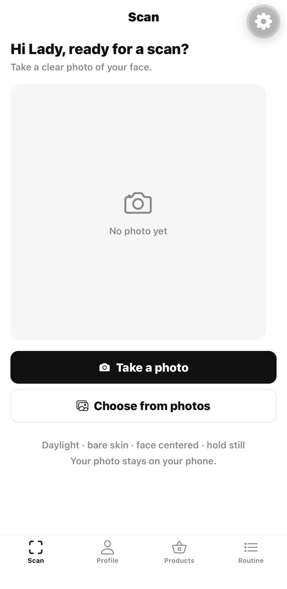
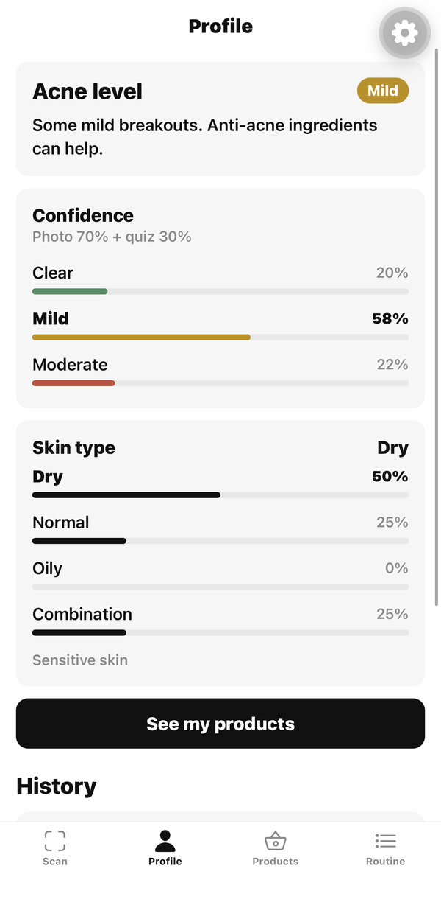
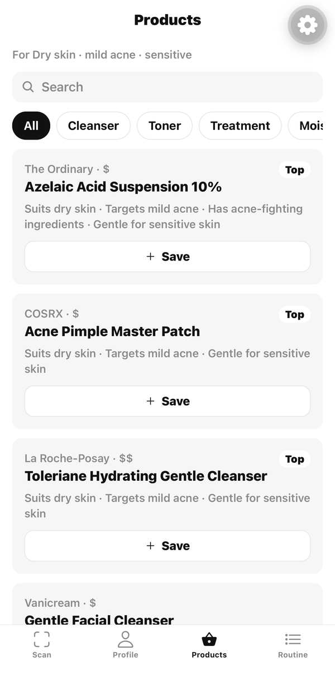
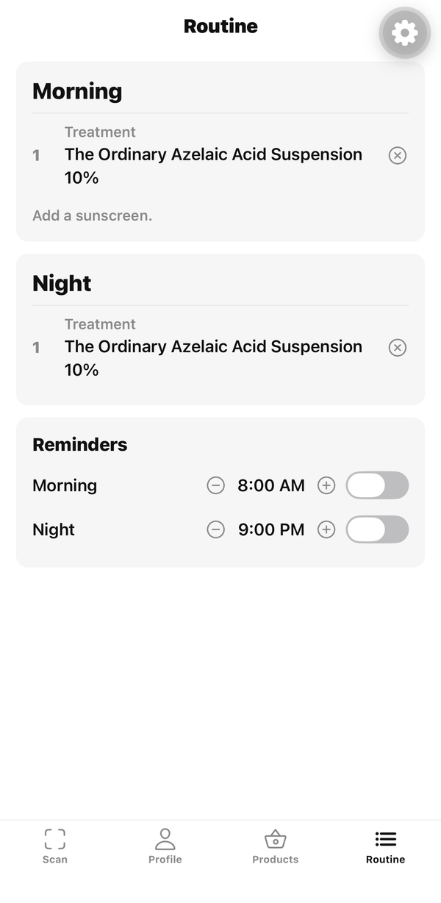

# The Skincare Guide: An AI-Powered Skincare Recommendation App

Junior IS · Lady Paris Asante · The College of Wooster

A React Native (Expo) mobile app. The user takes a short **Skin Quiz** and a photo of their skin. A fine-tuned **MobileNetV2** model finds the acne level (clear, mild or moderate) on the phone. A **content-based matching algorithm** then recommends products and builds an AM/PM routine.

Photos are analyzed on the device and never saved or uploaded.

## Screenshots

| Skin Quiz | Skin Scan | Skin Profile | Products | My Routine |
|---|---|---|---|---|
|  |  |  |  |  |

## Tech stack

| Part | Tool |
|---|---|
| App | React Native 0.88, Expo SDK 58 (development build) |
| On-device model | TensorFlow Lite through `react-native-fast-tflite` |
| Model training | TensorFlow / Keras, MobileNetV2 pre-trained on ImageNet |
| Storage | AsyncStorage (on the phone only) |
| Reminders | `expo-notifications` (local, no server) |
| Tests | Node's built-in test runner (`npm test`) |

## How to run

```
npm install
npx expo start --go
```
Scan the QR code with the iPhone Camera to open the app in Expo Go. Expo Go can't load TensorFlow Lite. So the scan shows a labeled **demo mode** estimate. To run the real model, make a development build with `npx expo run:ios --device`. This needs Xcode.

Run the unit tests (Node 22 or newer, no phone needed):

```
npm test
```

There are 21 tests in `tests/`. They check the Skin Quiz scoring and the 70/30 photo + quiz blend. They also check the model input scaling and the product matching.

## How it works

1. **Skin Quiz.** 6 questions are scored into a skin type, sensitivity and a breakout estimate (`src/logic/quiz.js`).
2. **Photo.** The photo is taken or chosen in `src/screens/ScanScreen.js`.
3. **Preprocessing.** The photo is made upright, center-cropped, resized to 224×224 and scaled to −1…1, the same as in training (`src/ml/preprocess.js`).
4. **Model.** `assets/models/concerns.tflite` runs on the device (`src/ml/classifier.js`).
5. **Photo + quiz.** Final acne level = 70% photo + 30% quiz (`blendWithPrior` in `src/ml/postprocess.js`).
6. **Matching.** Each product is scored on skin type, acne level, ingredients and sensitivity, then ranked with reasons (`src/logic/matching.js`).
7. **Storage.** Results, routine and settings are saved on the phone with AsyncStorage (`src/state/AppContext.js`).

## Project structure

```
App.js                      Bottom-tab navigation
src/screens/                Onboarding, Scan, Profile, Products, Routine screens
src/ml/                     Preprocessing, model loading, probabilities, settings
src/logic/quiz.js           Skin Quiz questions and scoring
src/logic/matching.js       Product recommendation algorithm
src/data/products.js        Product database (25 products, 6 categories)
src/state/AppContext.js     App state, saved on the device
src/notifications.js        Daily AM/PM routine reminders
src/components/UI.js        Shared buttons, cards, confidence bars
assets/models/              Trained TFLite model
tests/                      Unit tests (npm test)
docs/screenshots/           App screenshots used in this README
```

## Model training

The acne model is MobileNetV2, pre-trained on ImageNet. A new last layer sorts photos into clear, mild and moderate acne. Training had two phases:

| Setting | Phase 1 | Phase 2 |
|---|---|---|
| MobileNetV2 layers trained | None (base frozen), only the new head | Last 100 layers unfrozen |
| Learning rate | 1e-3 | 1e-4 |
| Epochs | 8 | Up to 25, early stopping (patience 6) |

Both phases used batch size 32 and dropout 0.3. Images were 224×224 and scaled to −1…1. Moderate acne had the fewest images. So each class got a balanced weight, *w = N / (K · n)*: clear 0.82, mild 0.73, moderate 2.43. The trained model was converted to TensorFlow Lite with 16-bit weights. The file is `concerns.tflite` (4.5 MB).

## Recommendation formula

Each product *j* gets a score from the user's profile (`src/logic/matching.js`):

*S = 3T + 4C + 1.5A + G − 2.5H − 2O − 1.5D*

- **T**: the product suits the skin type.
- **C**: the product fits the acne level, weighted by the model's probabilities.
- **A**: it has acne-fighting ingredients when acne is likely.
- **G**: it is gentle and the user has sensitive skin.
- **H**: it is not gentle and the user has sensitive skin.
- **O**: it is strong and the skin is mostly clear.
- **D**: it has a drying ingredient and the skin is dry.

Products are ranked by score. Each one shows the reasons for its score.


## Results

The app builds each user's skin profile from two parts:

| Part | What it gives | How |
|---|---|---|
| Skin Quiz (6 questions) | Skin type (dry, normal, oily, combination) and sensitivity | Each answer adds points to a skin type. Points become confidence scores. |
| Acne model (MobileNetV2, on the phone) | Acne level (clear, mild, moderate) | Photo prediction (70%) combined with the quiz's breakout question (30%) |

### Acne model (used in the app)

Tested on held-out images that were not used in training:

| Test accuracy | Macro F1 | Test images |
|---|---|---|
| 53.2% | 0.46 | 139 |

Most errors are between neighboring levels. For example, mild acne is often labeled as clear. The model almost never mixes up clear skin and moderate acne. The quiz's breakout answer helps fix this. If a user reports frequent breakouts, the estimate moves toward mild and moderate.

### Skin-type photo models (not used in the app)

Four MobileNetV2 versions were trained to classify skin type (dry, normal, oily) from a photo:

| Version | Main change | Test accuracy | Macro F1 |
|---|---|---|---|
| v1 | Original dataset folders (with data leakage) | 45.5% | 0.46 |
| v2 | Leakage removed | 42.9% | 0.29 |
| v3 | Zoomed to the center of the face | 40.0% | 0.35 |
| v4 | Two datasets, small skin patches | 35.4% | – |

The skin-type dataset had the same photos in its training and test folders. This made v1's score look better than it was. After these duplicates were removed, every version scored close to chance (about 33% for three classes). So the app gets skin type from the Skin Quiz instead.

### Skin Quiz

The quiz has not yet been tested against expert skin-type labels; this is listed under future work.


## Skin type: why the app uses a quiz

I trained four photo models for skin type (dry, normal, oily). Then I removed duplicate photos that were in both the training and test sets. After that, every version scored close to the baseline of always guessing the biggest class. The best one reached 40% test accuracy, against a 34–43% baseline. So the photo model is off. The app uses the Skin Quiz for skin type.

## Feature calendar

### Done
| Feature | Issue |
|---|---|
| Skin Scan, Profile, and Products screens | [#1](https://github.com/lady-igth/Junior-IS/issues/1) |
| Onboarding screen | [#2](https://github.com/lady-igth/Junior-IS/issues/2) |
| Skin Scan screen | [#3](https://github.com/lady-igth/Junior-IS/issues/3) |
| Buttons (take photo / choose / analyze) | [#4](https://github.com/lady-igth/Junior-IS/issues/4) |
| Select a photo from the library | [#5](https://github.com/lady-igth/Junior-IS/issues/5) |
| Photo capture | [#6](https://github.com/lady-igth/Junior-IS/issues/6) |
| Pre-trained image classification model (MobileNetV2) | [#7](https://github.com/lady-igth/Junior-IS/issues/7) |
| Fine-tuned acne classifier | [#8](https://github.com/lady-igth/Junior-IS/issues/8) |
| Skin Quiz, product matching, routine, reminders, scan history | [#12](https://github.com/lady-igth/Junior-IS/issues/12) |
| Bottom tab navigation | [#13](https://github.com/lady-igth/Junior-IS/issues/13) |

### Future work
| Feature | Why it was not included |
|---|---|
| Progress photo comparison over time (opt-in, stored only on the phone) | Scoped out to finish on time; scan history already tracks results over time |
| Test the Skin Quiz accuracy against labelled skin types | Needs a user study with reference skin-type labels |
| Fairness test: acne model accuracy across skin tones | The datasets do not record skin tone |
| Skin type photo model v5 with more diverse data | Needs a larger, dermatologist-labelled dataset with skin-tone variety |

## Privacy

Photos stay in memory only during the analysis. They are never saved or uploaded. Quiz answers, scan results and the routine are saved on the phone with AsyncStorage. The app needs no account and no internet connection.

## Disclaimer

This app is a student research project. It does not give medical advice. See a dermatologist for skin concerns. Product formulas change, so always check the label.
